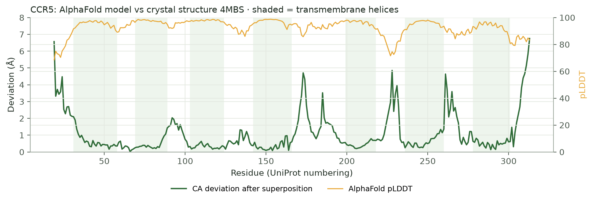
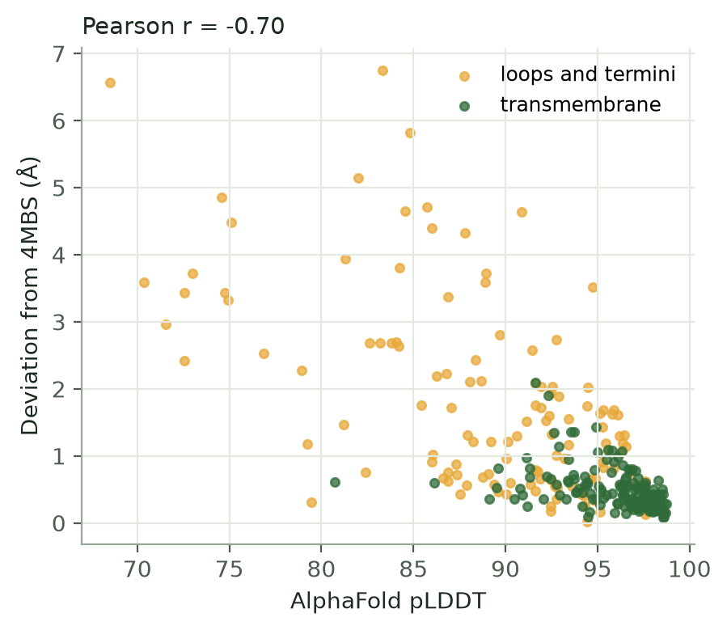
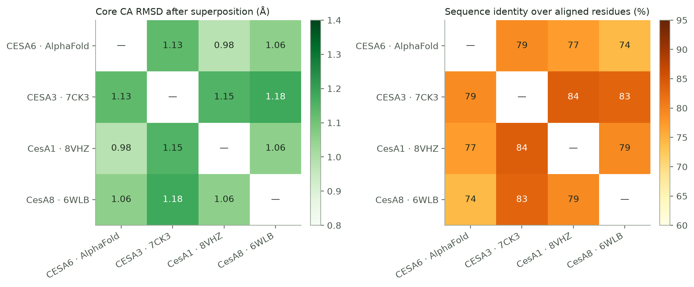
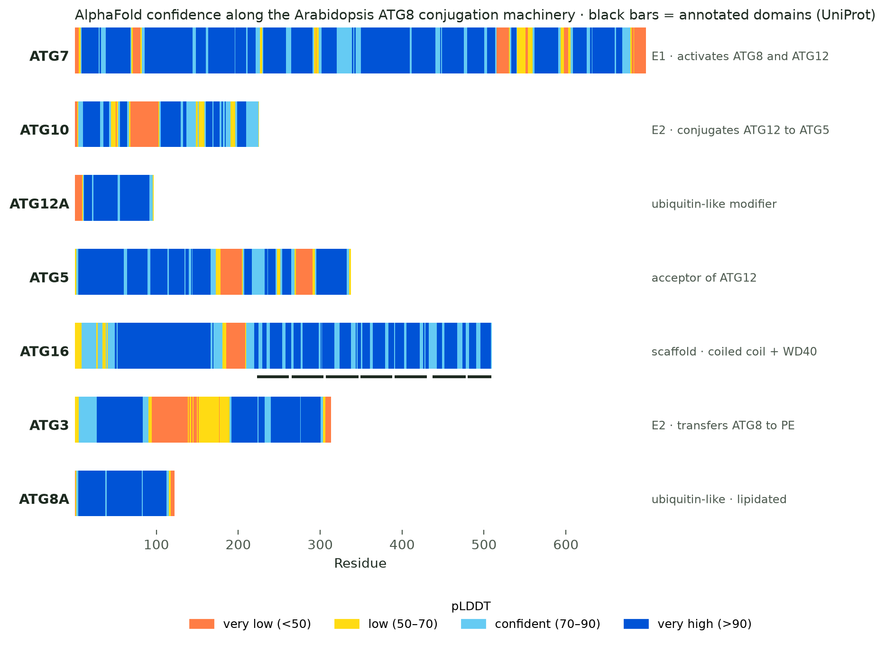
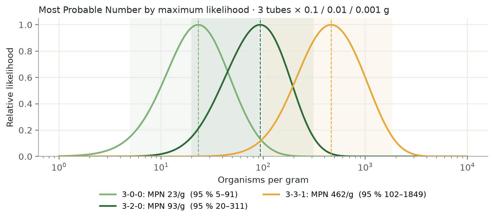

# Bioinformatics analyses

[](https://github.com/Alvar56/bioinformatics-analyses/actions/workflows/tests.yml)

Small, reproducible analyses in Python that sit next to the lab and industry work on
[my portfolio](https://alvar56.github.io): structural bioinformatics on public PDB and
AlphaFold data, and the arithmetic behind routine food-microbiology results. Each folder
is one question, one script, and the figures and tables it produces.

| | Question | Methods |
| --- | --- | --- |
| [01](01-ccr5-model-benchmark) | How close is AlphaFold's CCR5 to the crystal structure, and does pLDDT tell you where it is wrong? | sequence-matched CA superposition, per-residue deviation, UniProt topology |
| [02](02-cesa-structure-comparison) | With no experimental Arabidopsis CESA6 structure, which reference can stand in for it? | pairwise alignment, iterative superposition, identity vs RMSD matrices |
| [03](03-atg-conjugation-alphafold) | Which parts of the plant ATG8 conjugation machinery does AlphaFold model confidently? | AlphaFold DB, pLDDT bands, UniProt domain annotation |
| [04](04-food-micro-qc) | How are plate counts and MPN results actually calculated? | ISO 7218 weighted mean, maximum-likelihood MPN, likelihood-ratio intervals, unit tests |

---

## 01 · AlphaFold vs experiment: human CCR5

The AlphaFold model of CCR5 ([P51681](https://www.uniprot.org/uniprotkb/P51681)) against the
maraviroc-bound crystal structure ([4MBS](https://www.rcsb.org/structure/4MBS)), after removing
the rubredoxin fusion and matching residues by sequence.



| Metric | Value |
| --- | --- |
| Residues compared | 292 |
| CA RMSD, all matched residues | 1.55 Å |
| CA RMSD, transmembrane helices only | **0.57 Å** |
| Core within 4 Å after iterative fit | 281 residues, 1.22 Å |
| Correlation pLDDT vs deviation | r = −0.70 |

**Reading:** the seven-helix bundle is essentially exact; the error sits in the termini and the
loops (ECL2, ICL3, ECL3), which are also where pLDDT drops. For docking into the transmembrane
pocket the model is as good as the crystal; for anything involving ECL2 or the N-terminus it is not.



## 02 · Stand-ins for Arabidopsis CESA6

Four candidate references for structure-based work on CESA6: its AlphaFold model, the
Arabidopsis CESA3 catalytic domain ([7CK3](https://www.rcsb.org/structure/7CK3), X-ray), and the
soybean CesA1 ([8VHZ](https://www.rcsb.org/structure/8VHZ)) and poplar CesA8
([6WLB](https://www.rcsb.org/structure/6WLB)) cryo-EM trimers.



**Reading:** every pair agrees to 1.0–1.2 Å over its structural core, at 74–84 % identity, so
the catalytic fold is interchangeable. What differs is coverage: 7CK3 is the catalytic domain
only (about 80 % of the shared core), while the cryo-EM structures also include the
transmembrane region (95–98 %). Cross-checking a prediction against all four is cheap and
catches reference-specific artefacts. Full table in [results.md](02-cesa-structure-comparison/results.md).

## 03 · AlphaFold confidence across the ATG8 conjugation machinery

ATG7 (E1), ATG10 and ATG3 (E2s), ATG12, ATG5 and ATG16 build the cascade that attaches ATG8
to membrane lipids. pLDDT along each Arabidopsis protein, in AlphaFold DB colours:



**Reading:** the ubiquitin-like folds (ATG8A, ATG12A), the ATG7 core and the ATG16 WD40
β-propeller are modelled with very high confidence. The low-confidence stretches are the
flexible regions: the long ATG3 flexible region, an internal ATG10 insert and two ATG5 loops. Those are exactly the
regions to treat with care before modelling interactions. Per-protein numbers in
[results.md](03-atg-conjugation-alphafold/results.md).

## 04 · Food-microbiology QC calculations

[`microqc.py`](04-food-micro-qc/microqc.py) implements the two calculations behind most
routine results in a food-safety lab, with tests against published reference values.

- **Plate counts:** the ISO 7218 weighted mean over two successive dilutions,
  N = ΣC / (V · (n₁ + 0.1 n₂) · d), keeping plates with 10–300 colonies, and two-significant-figure
  reporting. The ISO worked example (168, 215 at 10⁻²; 14, 25 at 10⁻³) gives 1.9 × 10⁴ CFU/g.
- **Most Probable Number:** maximum-likelihood estimate for any tube series, solved by
  bisection on the score function, with a likelihood-ratio 95 % interval. Matches the FDA
  BAM 3-tube table to within 1 %.



---

## Run

```bash
python -m venv .venv && . .venv/bin/activate      # Windows: .venv\Scripts\activate
pip install -r requirements.txt

python 01-ccr5-model-benchmark/benchmark.py
python 02-cesa-structure-comparison/compare.py
python 03-atg-conjugation-alphafold/survey.py
python 04-food-micro-qc/microqc.py
python 04-food-micro-qc/plot_mpn.py
pytest -q
```

Structures are downloaded from RCSB PDB, AlphaFold DB and UniProt on first run and cached in
`data/`. Shared code lives in [`common/`](common): download helpers, CA extraction,
sequence-based residue matching, Kabsch superposition with iterative outlier rejection, and one
plotting style.

## Related

- [structure-renders](https://github.com/Alvar56/structure-renders) · ChimeraX pipeline for consistent protein figures
- [tonoplast-scenes](https://github.com/Alvar56/tonoplast-scenes) · Blender + Molecular Nodes scenes of the vacuole membrane

Alvar Pascual García · biotechnologist (MSc, BOKU Vienna) · [alvar56.github.io](https://alvar56.github.io)
